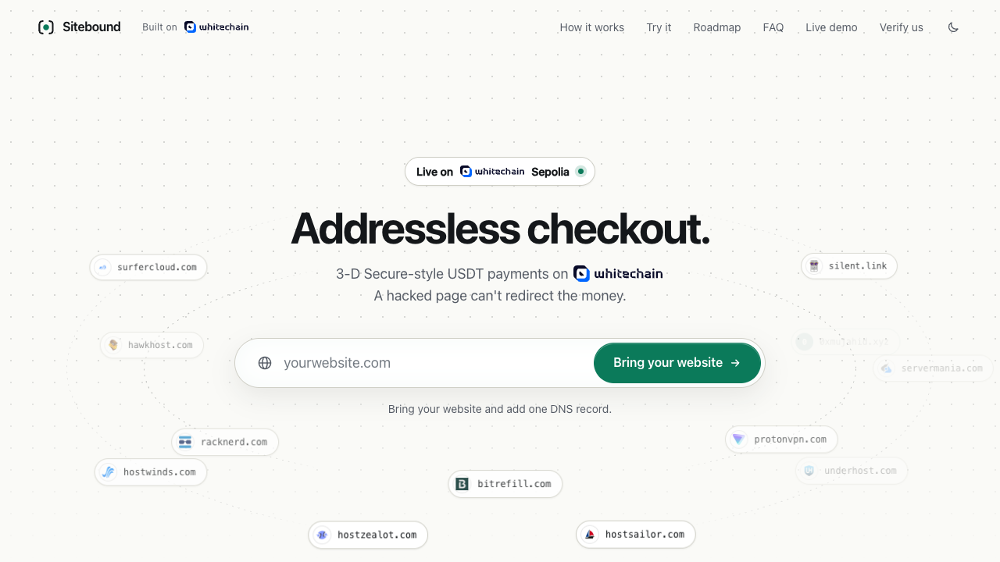
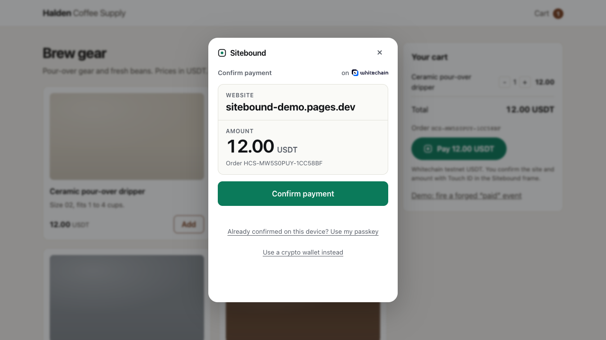
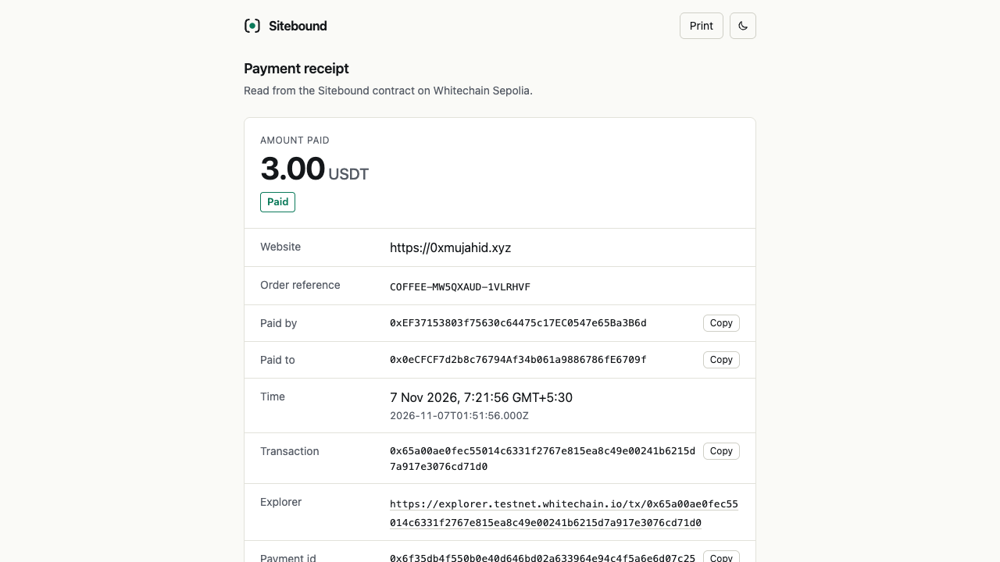
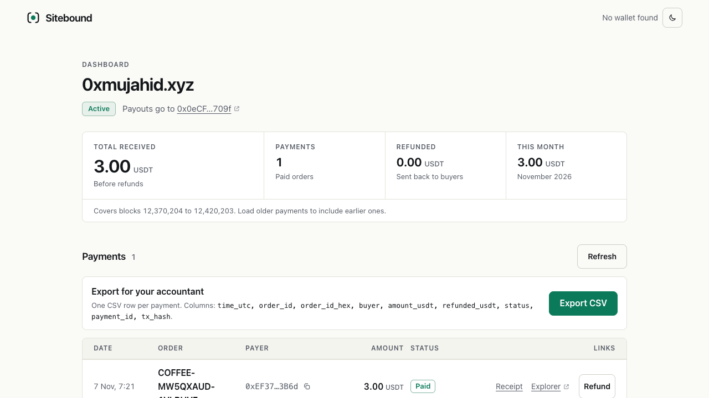
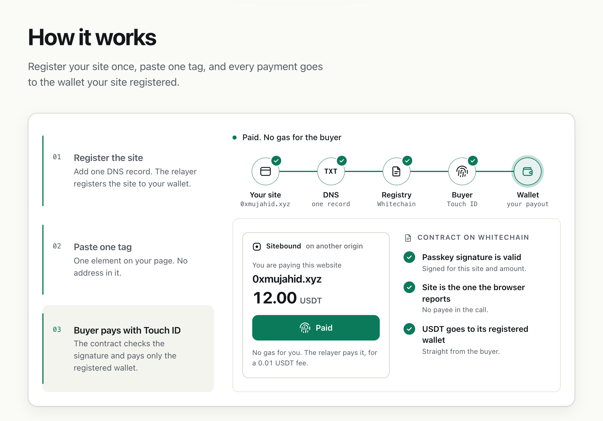
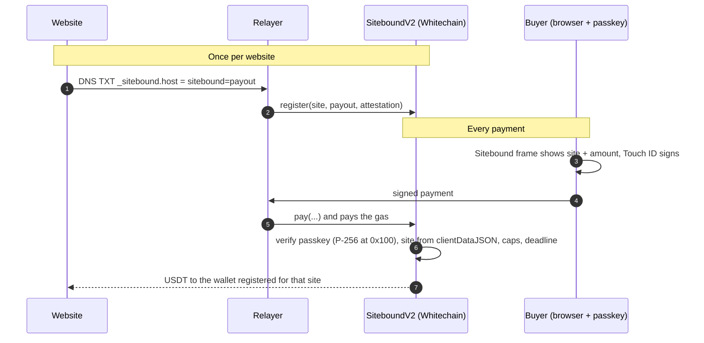

<div align="center">

# Sitebound

**Addressless checkout.** 3-D Secure-style USDT payments on Whitechain: every payment is bound to the website, so a hacked page can't redirect the money.

[](https://explorer.testnet.whitechain.io/address/0x64117398C837a8708a816818b31C36Df5a968596?tab=contract)
[](#run-it)
[](src/SiteboundV2.sol)
[](https://repo.sourcify.dev/1874/0x64117398C837a8708a816818b31C36Df5a968596)
[](https://ethglobal.com/events/mumbai/prizes)
[](LICENSE)

[**Live app**](https://sitebound-pay.pages.dev) &nbsp;·&nbsp; [Demo shop](https://sitebound-demo.pages.dev) &nbsp;·&nbsp; [Real site: 0xmujahid.xyz](https://0xmujahid.xyz) &nbsp;·&nbsp; [First real payment](https://explorer.testnet.whitechain.io/tx/0x65a00ae0fec55014c6331f2767e815ea8c49e00241b6215d7a917e3076cd71d0) &nbsp;·&nbsp; [Docs](#docs)



</div>

> Built at **[ETHGlobal Mumbai 2026](https://ethglobal.com/events/mumbai/prizes)** on Whitechain Sepolia testnet, by [mujahid002](https://github.com/mujahid002) and [sowjanyalakshmi001](https://github.com/sowjanyalakshmi001).

## What it is

A website registers its payout wallet once (one DNS TXT record proves it owns the domain). The buyer approves the
website and the amount with a passkey (Touch ID). The contract checks the browser-signed site and pays only that site's
registered wallet. **`pay()` has no payee field**, so compromised checkout JavaScript can change the page, not who gets
paid.

This defends against **recipient substitution**: hacked code on a real website swapping who gets paid. It is not
phishing protection (a lookalike domain that registers its own wallet is a separate threat; the fake-site demo shows
it). **Plainly:** a 3-D Secure-style confirmation, not hack-proof. Testnet only (testnet USDT has no value), not
audited. Full trust model: [docs/THREAT-MODEL.md](docs/THREAT-MODEL.md).

<table>
<tr>
<td width="50%"><br><sub><b>Checkout.</b> The buyer sees the site and the amount, then confirms with Touch ID.</sub></td>
<td width="50%"><br><sub><b>Receipt.</b> Read straight from the chain, no server.</sub></td>
</tr>
<tr>
<td width="50%"><br><sub><b>Dashboard.</b> Payments to one site from chain events, refunds, CSV.</sub></td>
<td width="50%"><br><sub><b>How it works.</b> Register once, paste one tag, confirm each payment.</sub></td>
</tr>
</table>

## Try it

| | Link |
|---|---|
| Live app: landing, onboarding, checkout frame | https://sitebound-pay.pages.dev |
| Demo shop | https://sitebound-demo.pages.dev |
| Real site using it ("Buy me a coffee") | https://0xmujahid.xyz |
| Attack demos | [Address swap](https://sitebound-demo.pages.dev/attack/), [fake site and overlay](https://sitebound-phish.pages.dev) |
| Dashboard for 0xmujahid.xyz | [sitebound-pay.pages.dev/dashboard](https://sitebound-pay.pages.dev/dashboard/?site=0xmujahid.xyz) |
| First real USDT payment (testnet transaction) | [`0x65a00ae0…71d0`](https://explorer.testnet.whitechain.io/tx/0x65a00ae0fec55014c6331f2767e815ea8c49e00241b6215d7a917e3076cd71d0) · [receipt](https://sitebound-pay.pages.dev/receipt/?id=0x6f35db4f550b0e40d646bd02a633964e94c4f5a6e6d07c2537cfe67d14fab9d6) |
| Contract SiteboundV2, verified source | [`0x6411…9596`](https://explorer.testnet.whitechain.io/address/0x64117398C837a8708a816818b31C36Df5a968596?tab=contract) |
| Relayer health | https://sitebound-relayer.sitebound-relayer.workers.dev/health |

Need testnet funds to pay? The landing page's **Try it** section lists the Whitechain faucet and the USDT swap steps.

## The problems

1. **Hacked checkout code swaps addresses.** The website's address lives in its checkout JavaScript. One compromised
   dependency rewrites it and the money goes to the attacker. The npm "qix" compromise in Sep 2025 rewrote crypto
   recipients this way. More in [docs/WHY.md](docs/WHY.md).
2. **Addresses are bad checkout UX.** Buyers copy, paste or scan 40 hex characters they can't read.
3. **Crypto has no 3-D Secure.** Card buyers get a confirmation that shows the merchant and the amount. Crypto buyers
   sign raw transactions.
4. **Buyers need gas.** With Sitebound a relayer pays the gas and the buyer pays a 0.01 USDT fee.
5. **Hard for a web2 business to start (our view).** Sitebound's onboarding is a domain, a wallet created in the
   browser and one DNS record.

## How it works



- **Website, once.** DNS TXT record `_sitebound.<host>` = `sitebound=<payout>`. The attestor checks it and signs, and
  anyone can submit `register()`. The website pastes one script tag and a `<sitebound-pay amount="12.00" order="A123">`
  element. There is no address in its code. The onboarding wizard creates the payout wallet in the browser.
- **Buyer, first time.** In a popup on the Sitebound origin: connect a wallet, pick limits, create a passkey, sign a
  capped EIP-2612 permit and an EIP-712 binding (passkey key, per-payment cap, total cap, expiry).
- **Buyer, every payment.** The button opens the Sitebound frame in a cross-origin iframe, which shows the site (from
  `location.ancestorOrigins`) and the amount, then calls WebAuthn `get()`. One Touch ID signs one exact payment.
- **Contract.** Chrome writes the embedding page's origin into the signed `clientDataJSON` as `topOrigin`, and page
  code can't change it. `pay()` checks the passkey signature with the P-256 precompile, checks the signature came from
  the Sitebound frame, and moves USDT to the split registered for `keccak256(topOrigin)`.

**Why on-chain settlement:** the registry binds each site to a payout wallet and `pay()` takes no payee argument, so
no server or page can redirect the money, and anyone can read and verify the rules. An off-chain processor can't give
the buyer that guarantee. All diagrams: [docs/ARCHITECTURE.md](docs/ARCHITECTURE.md).

## Why Whitechain

Sitebound runs on Whitechain Sepolia (chain 1874) because the chain has the pieces the design needs, checked on 4 to
6 Nov 2026. Details, and what was hard, are in [WHITECHAIN_FEEDBACK.md](WHITECHAIN_FEEDBACK.md).

- **P-256 precompile at `0x100` (RIP-7212).** The contract verifies every passkey (Touch ID) signature on chain.
  Without it, each payment would need a Solidity P-256 verifier. Gas of `pay()` on Whitechain: 305,060 for the one real payment below (a single sample, testnet).
- **USDT with EIP-2612 `permit`.** The buyer grants the capped allowance with a signature, so the relayer can pay
  all the gas and the buyer never needs WBT.
- **A public RPC with no key** (`https://rpc.testnet.whitechain.io`), so the frame, the dashboard and "Verify us" read
  the chain straight from the browser.
- **Verified source.** SiteboundV2 is verified on the Whitechain explorer (Blockscout) and on Sourcify.

## Repo map

Diagrams of each flow: [docs/ARCHITECTURE.md](docs/ARCHITECTURE.md).

| Part | Path | What it does |
|---|---|---|
| Contract | `src/SiteboundV2.sol` | Site registry with splits and site roles, k-of-n attestors, passkey bindings with caps, `pay()`, refunds. Deprecated v1: `src/Sitebound.sol`. |
| Frame | `web/frame/` | Checkout iframe (`get()` only) and the first-time setup popup. Vanilla JS and vendored ethers 6.17.0. |
| Button | `web/button/sitebound.js` | The `<sitebound-pay>` element. It opens the frame from its own host and fires `sitebound:paid`. |
| Merchant helper | `web/merchant/sitebound-merchant.mjs` | `verifyPayment` and `signQuote`, for the website's server. |
| Relayer (optional) | `worker/` | Cloudflare Worker. It pays gas for `register`, `permit`, `bind` and `pay`, and is also the DNS attestor. See `worker/README.md`. |
| Onboarding | `web/onboard/` | Website setup: payout wallet (created in the browser or your own), DNS TXT check, register, snippet. |
| Dashboard | `web/dashboard/` | Payments to one site from chain events, refunds, CSV. |
| Receipt | `web/receipt/` | One payment's receipt, read from the chain: `/receipt/?id=<paymentId>` or `?tx=<hash>`. |
| Pay link | `web/pay/` | Builds a standalone pay page for the owner's own origin. |
| Landing | `web/landing/` | The public page, served at the site root. |
| Portfolio | `web/portfolio/` | The real-domain demo at https://0xmujahid.xyz (its own Pages project; `deploy/pages.sh` does not deploy it). |
| Demo site | `web/demo-shop/` | A site whose checkout is only the `<sitebound-pay>` element. |
| Attack demos | `web/attack/` | An address swap on a classic checkout, the same script against Sitebound, and a fake site embedding the frame. |

The relayer only pays gas. `pay()` is permissionless and the payee comes from the registry, so a relayer can refuse
a payment but can't redirect one. The frame also offers "Pay from my wallet": the buyer submits `pay()` with
`relayerFee = 0` and pays gas in WBT.

## Run it

Requires Foundry, Node, Python 3 and Chrome (the only browser measured so far).

```sh
forge install foundry-rs/forge-std   # lib/ is not committed
forge test                           # v1, SiteboundV2 and the V2 invariant suites
node web/dev/check-lib.mjs           # the frame's encoders and the merchant helper, on the real Chrome fixture
(cd worker && npm install && node test/local.mjs)  # relayer against anvil, then under wrangler dev
(cd e2e && npm install && npm test)                # headless Chromium: setup, pay, refund, demo site, quotes
python3 web/dev/serve.py             # site http://127.0.0.1:8001, frame http://localhost:8002
```

More (local pages, deploying the contract, adding a site without DNS): [docs/DEVELOPMENT.md](docs/DEVELOPMENT.md).

## Verify it yourself

Three independent checks that the deployed contract is this code: `sh scripts/verify.sh` (rebuilds and compares the
runtime code), the Sourcify and Whitechain explorer verification, and "Verify us" in the browser at
https://sitebound-pay.pages.dev/#verify. Details and addresses: [docs/DEPLOYMENTS.md](docs/DEPLOYMENTS.md).

## Threat model (summary)

The full version, with line references, is [docs/THREAT-MODEL.md](docs/THREAT-MODEL.md).

- **Stops:** hacked checkout JavaScript on the real website redirecting a payment. A fake site embedding the frame
  can only pay its own registry entry.
- **Does not stop:**
  - a lookalike domain that registered its own wallet;
  - a page drawn over the frame (UI redressing);
  - a hacked page asking for a different amount, unless the site uses quotes.
- **Trusted:**
  - the attestors' DNS check. 1-of-1 is one trusted authority, not decentralized; rotation at k = 1 adds no safety;
  - the frame host's code;
  - the buyer's browser;
  - the guardian, for liveness only;
  - the USDT issuer.
- **Relayer only:** the daily caps and the minimum fee are enforced by the relayer, not on-chain.
- **Owner key:** a stolen owner key can freeze a site permanently.
- **Browsers:** Safari may omit `topOrigin` (not measured), and a missing `topOrigin` fails closed. Firefox: not
  checked.

## Docs

| Doc | What is in it |
|---|---|
| [Why we are building it](docs/WHY.md) | The attacks on web checkout code, and the name |
| [Architecture](docs/ARCHITECTURE.md) | Diagrams of the parts, onboarding, setup, a payment and the attacker |
| [Threat model](docs/THREAT-MODEL.md) | What it stops, what it trusts, known limits |
| [Whitechain prize checklist](docs/WHITECHAIN.md) | Each requirement with its evidence |
| [Whitechain feedback](WHITECHAIN_FEEDBACK.md) | What worked and what broke on Whitechain |
| [Deployments and verification](docs/DEPLOYMENTS.md) | Addresses, transactions, three ways to verify |
| [For websites](docs/MERCHANTS.md) | Settings, server-side payment check, merchant quotes |
| [Development](docs/DEVELOPMENT.md) | Local run, deploy, add a site without DNS |
| [Prior art, CROPS, multi-chain](docs/PRIOR-ART.md) | What exists, what is new, why single-chain today |
| [Demo video script](docs/demo-script.md) · [Relayer](worker/README.md) | |

## AI use

Claude Code wrote much of the code, tests, pages and these docs under the author's direction. The author made the
design calls and reviewed the changes, and signs every transaction; the AI never held a key. Claims in this repo
that were not measured are marked "not checked".

## License

MIT, see [LICENSE](LICENSE).
