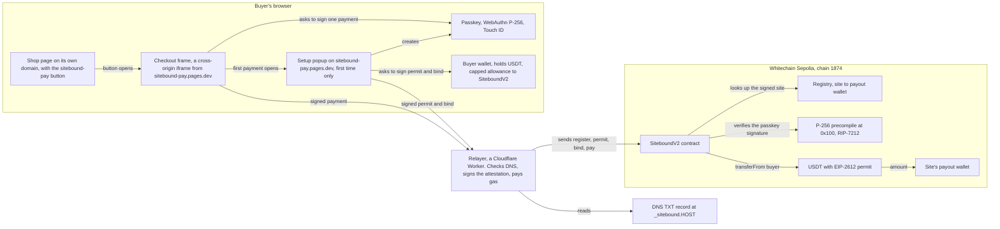
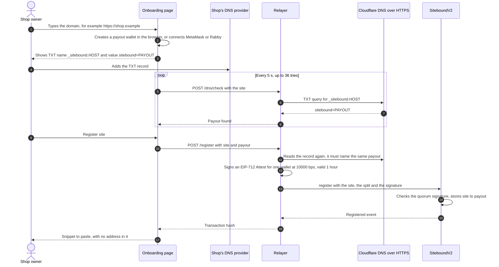
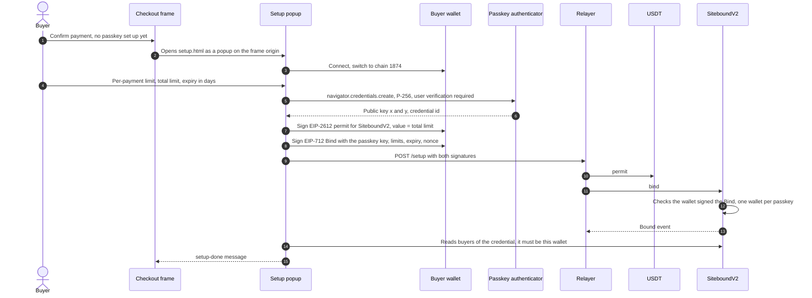
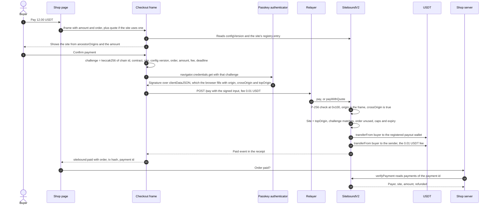
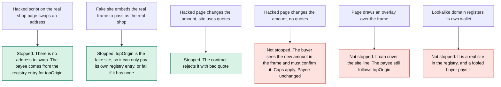

# Architecture

How the parts of Sitebound fit together, with the code that does each step. Line numbers are for the files as of
this commit. The trust model and its limits are in [THREAT-MODEL.md](THREAT-MODEL.md).

## Parts

| Part | Code | Job |
|---|---|---|
| Button | `web/button/sitebound.js` | The `<sitebound-pay amount order>` element. Opens the frame in a modal `<dialog>` (`:51`–`:63`) and re-fires `sitebound:paid` (`:69`–`:71`). It holds no address. |
| Frame | `web/frame/frame.js`, `lib.js` | Reads the site from `location.ancestorOrigins` (`:15`–`:18`), shows site and amount, asks the passkey to sign, sends the result to the relayer. |
| Setup popup | `web/frame/setup.js` | First time only: wallet, caps, passkey, permit and bind signatures. |
| Onboarding | `web/onboard/app.js` | A shop's wallet, DNS record, registration and snippet. |
| Contract | `src/SiteboundV2.sol` | Registry, attestors, passkey bindings with caps, `pay()`, refunds. No owner, no upgrade path. |
| Relayer | `worker/src/index.js` | `/dns/check`, `/register`, `/setup`, `/pay`, `/health`. The only attestor (1-of-1) and the gas payer. |
| Merchant helper | `web/merchant/sitebound-merchant.mjs` | `verifyPayment` and `signQuote` for the shop's server. |

## Onboarding a shop

- The wallet is `ethers.Wallet.createRandom()`, kept in that browser's `localStorage` with an optional backup
  (`web/onboard/lib.js:203`, `:216`–`:224`). The owner signs nothing and pays no gas to register.
- The relayer reads `_sitebound.<host>` over Cloudflare DNS-over-HTTPS, without DNSSEC (`worker/src/index.js:65`–`:83`).
  Two lists skip DNS: `DEMO_SITES` and sites added through the admin API (`:160`–`:165`).
- A new site is live at once. A new payout for a site that is already registered waits `delay` (1 hour on the
  deployment), and the current owner can freeze it in that window (`src/SiteboundV2.sol:288`–`:299`).

## A buyer's first-time setup

- The passkey comes first because the Bind signature includes its public key (`web/frame/setup.js:99`–`:113`).
- The relayer refuses limits below its fee, simulates both calls, then sends `permit` and `bind`
  (`worker/src/index.js:201`–`:227`). If the relayer fails, "Submit from my wallet instead" sends both from the buyer's wallet,
  which then pays the gas (`setup.js:152`–`:173`).
- After setup, a payment needs no wallet popup. The caps live in the contract (`src/SiteboundV2.sol:621`–`:627`).

## A payment

- The challenge is built in the frame (`web/frame/lib.js:56`–`:62`) and rebuilt in the contract
  (`src/SiteboundV2.sol:645`–`:650`). It names the chain and the contract, so a signature cannot be replayed
  elsewhere, and the site's config version, so it cannot execute after a payout or settings change. The deadline is
  10 minutes (`frame.js:89`).
- The contract reads the site from `topOrigin` (`:639`–`:640`) and pays the split registered for it (`_settle`,
  `:659`–`:686`). `pay()` has no payee field.
- The fee goes to `msg.sender` (`:681`), whoever submits. It is capped on chain at 1 USDT (`maxRelayerFee`), and the
  relayer asks for at least 0.01 USDT (`MIN_FEE` in `worker/wrangler.toml`).
- "Use a crypto wallet instead" skips the relayer: fee 0, and the buyer's wallet sends `pay()` and pays the gas in WBT
  (`frame.js:124`–`:128`, `web/frame/wallet.js:39`–`:44`).
- The frame trusts the chain, not the relayer: it waits for a `Paid` log for this payment id (`frame.js:155`–`:162`).
  The shop's server should do the same with `verifyPayment` (`web/merchant/sitebound-merchant.mjs:52`–`:63`), because
  any script on the page can fire `sitebound:paid`.

## What an attacker can and cannot do

- Sitebound fixes **who gets paid**, not whether the buyer is on the right site. It is a 3-D Secure-style
  confirmation, not phishing protection and not hack-proof.
- Trusted: the attestor's DNS check (today one key, the relayer's), the frame host's code, the buyer's browser, and
  the USDT issuer. Details and line references: [THREAT-MODEL.md](THREAT-MODEL.md).
- The demos: [address swap](https://sitebound-demo.pages.dev/attack/), and a
  [fake site with the overlay](https://sitebound-phish.pages.dev).
